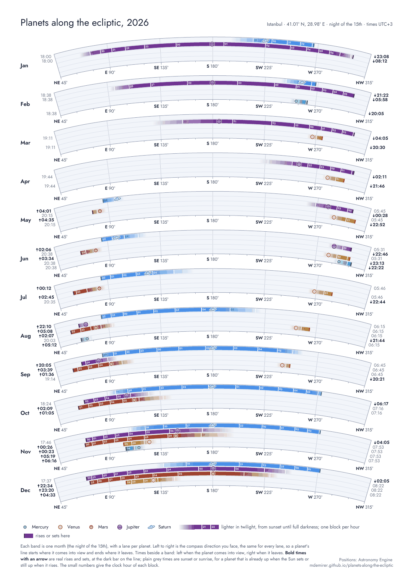

# Planets along the ecliptic

Printable A3 charts that show when and where to look for Mercury, Venus, Mars, Jupiter and Saturn, night by night, for any year and place between 30° and 60° latitude.

**Make your own:** https://mdemirer.github.io/planets-along-the-ecliptic/

Type a year, a place and its time zone, and the page draws three charts and gives you each one as a vector PDF. Everything is computed in your browser; nothing is sent to a server.



## The three charts

| Chart | Pages | Bands |
|---|---|---|
| Monthly | 1 × A3 | the 15th of every month, with the clock hour written on each block |
| Every two weeks | 2 × A3 (January–June, July–December) | the 1st and 15th of every month |
| Weekly | 2 × A3 | every seventh day, starting on 1 January |

Example PDFs for Istanbul, 2026: [monthly](examples/planets-2026-istanbul-monthly.pdf) · [every two weeks](examples/planets-2026-istanbul-biweekly.pdf) · [weekly](examples/planets-2026-istanbul-weekly.pdf)

## How to read a chart

- **Each band is one night.** Left to right is the compass direction you face: northeast to northwest through south in the northern hemisphere, southwest to southeast through north in the southern one. The scale is the same for every band.
- **Each planet has a lane**, Mercury at the bottom and Saturn at the top. A planet's line starts at the direction where it comes into view and ends where it leaves.
- **Colour shows the sky.** The line fades in from sunset, through twilight, to full colour when the Sun is 18° down, and fades out again towards sunrise. A white cut marks every full clock hour.
- **The planet symbol** sits at the best moment to look: its highest point in a dark sky (or in late twilight, for planets that only show up low near the Sun).
- **Times beside a band** give when each planet comes into view and when it leaves. Bold times with an arrow are real rises (↑) and sets (↓), also marked by a dark bar on the line. Plain grey times are sunset or sunrise, for a planet that is already up when the Sun sets or still up when it rises.

## How it works

- **Positions** come from [Astronomy Engine](https://github.com/cosinekitty/astronomy) (MIT licence), which models the planets with VSOP87 to about one arcminute. For each night the page samples every 2 minutes from local noon to the next noon, at the observer's position.
- **Rise and set** use the standard definitions: a planet is up when its centre is above −0.57° (refraction), the Sun has set when its centre is below −0.83°. Planets count as visible once the Sun is 6° down; full darkness starts at 18°.
- **A planet is left out** for a night if it never gets more than 3° above the horizon while the sky is dark enough to see it.
- **Times** are local clock time in the chosen time zone, with daylight saving changes handled by the browser's own time-zone data.
- **PDFs** are drawn as SVG and converted in the browser with [jsPDF](https://github.com/parallax/jsPDF) and [svg2pdf.js](https://github.com/yWorks/svg2pdf.js), with the [Jost](https://github.com/indestructible-type/Jost) font embedded.
- The results were cross-checked against [Skyfield](https://rhodesmill.org/skyfield/) with the JPL DE421 ephemeris; rise, set and twilight times agree to within a minute and directions to a fraction of a degree.

### Limits

- Latitudes from 30° to 60°, north or south. Closer to the equator planets can pass overhead and on both sides of the sky; further from it summer nights never get dark and some planets never set.
- Each band is one night. Jupiter and Saturn rise about 4 minutes earlier every day, Mercury and Venus change faster.
- The chart shows direction, not height above the horizon. The Moon is not shown.

## Run it locally

The page uses a Web Worker, so it needs a web server rather than opening the file directly:

```sh
python3 -m http.server 8000
# then open http://localhost:8000
```

## Publish on GitHub Pages

1. Push this folder to a GitHub repository.
2. In the repository, open **Settings → Pages**, choose **Deploy from a branch**, branch `main`, folder `/ (root)`.
3. The site appears at `https://<user>.github.io/<repository>/`.

If you use a different user or repository name, also change the links in `index.html` and `SITE_FALLBACK` in `js/app.js` (the address printed on charts made from a local copy).

## Files

```
index.html            the page
css/site.css          page styles
js/app.js             form, progress, previews, PDF download
js/worker.js          runs the calculation off the main thread
js/astro.js           planet visibility for one night (Astronomy Engine)
js/chart.js           draws the A3 pages as SVG
fonts/                Jost Regular and SemiBold, SIL Open Font License
vendor/               Astronomy Engine, jsPDF, svg2pdf.js and their licences
examples/             example PDFs and the preview image
```

## Licence

The code and chart design are released under the [MIT licence](LICENSE). Third-party components keep their own licences; see [THIRD_PARTY_NOTICES.md](THIRD_PARTY_NOTICES.md).
